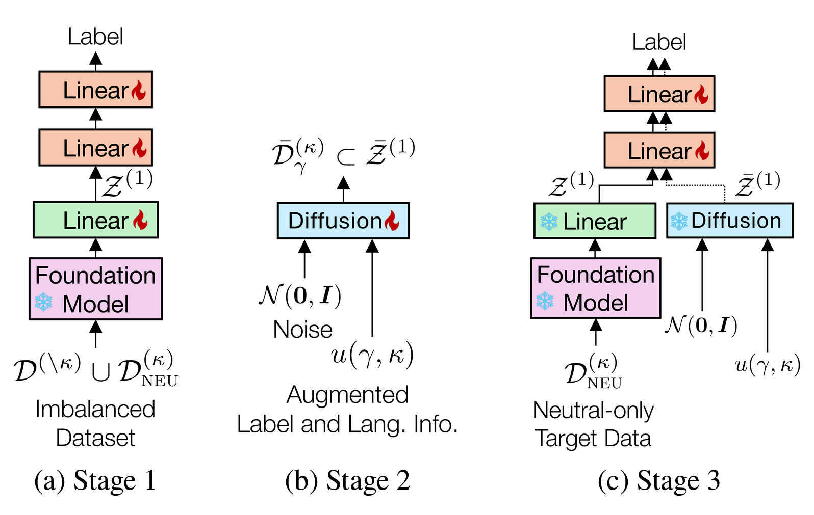

# GeLDA: Semantics-Aware Generative Latent Data Augmentation for Zero-shot Speech Emotion Recognition

Official implementation of

> **Semantics-Aware Generative Latent Data Augmentation for Zero-shot Speech Emotion Recognition**<br>
> Jaesung Bae and Minje Kim

GeLDA performs **zero-shot speech emotion recognition (SER) in 10 languages**, where only neutral speech of the
target language is available, and **few-shot SER in 12 languages**, where the emotional data is limited and
imbalanced. Checkpoints for every language are released, so emotion scores for a waveform take a few lines of
code ([Quick usage](#quick-usage)).

To do so, GeLDA trains a small conditional diffusion model (21M parameters) in the latent space of a frozen
speech foundation model (SFM) and uses it to synthesise emotional speech *representations* for the target
language. The diffusion model is conditioned on the emotion class and on the latent of a randomly drawn
utterance of the target language (the *language reference*), which lets it transfer emotion structure from
high-resource languages to the target language.

<p align="center">
  
</p>
<p align="center">
  <b>Figure 1.</b> GeLDA for zero-shot SER with augmentation in Z<sup>(1)</sup>.
  (a) Training the task adapter on a frozen SFM.
  (b) Training a latent diffusion model conditioned on emotion and language.
  (c) Fine-tuning the layers above Z<sup>(1)</sup> with real neutral and generated latents.
</p>

## Contents

- [Installation](#installation)
- [Quick usage](#quick-usage)
- [Data](#data)
- [Pretrained checkpoints](#pretrained-checkpoints)
- [Training from scratch](#training-from-scratch)
- [Citation](#citation)

## Installation

```bash
git clone https://github.com/JaesungBae/GeLDA.git
cd GeLDA
pip install -e .                # core: torch, speechbrain, numpy, scikit-learn, safetensors, einops, tqdm
pip install -e ".[features]"    # + transformers, funasr (to encode audio with the SFMs)
```

The SER task adapter is trained with [SpeechBrain](https://speechbrain.github.io) 0.5.16, the version used for
the paper (it needs a `torchaudio` build that matches your `torch`). The SER stages of the paper were run with
Python 3.9 and PyTorch 2.0.1. The diffusion model needs PyTorch >= 2.1; the whole pipeline was tested with
PyTorch 2.8.

Feature extraction from video containers (e.g. MELD, eNTERFACE) also needs `ffmpeg`.

```
gelda/                 library
  emobox.py            builds the paper's manifests from EmoBox metadata
  features.py          SFM features (Z(0))
  adapter.py           SER task adapter
  inference.py         emotion recognition for an audio file
  recipe.py            SpeechBrain recipe that trains the adapter (Stages 1 and 3)
  ser.py               latent loading and evaluation
  diffusion/           latent diffusion model, training data, sampler (Stage 2)
scripts/               one script per pipeline step
configs/diffusion/     diffusion configs for each SFM and latent space
configs/ser/           SpeechBrain hyperparameters of the task adapter
recipes/               end-to-end zero-shot and few-shot recipes
```

## Quick usage

Recognise the emotion of an audio file with a released GeLDA model (here French with Whisper-large-v3):

```bash
pip install -e ".[features]"
huggingface-cli download jaesungbae/GeLDA --local-dir checkpoints --include "zero_shot/whisper-large-v3/french/fold1/*"
```

```python
from gelda.inference import EmotionRecognizer

recognizer = EmotionRecognizer("checkpoints/zero_shot/whisper-large-v3/french/fold1/ser_adapter_gelda_z0.safetensors")
scores = recognizer("utterance.wav")   # {"Angry": 0.00, "Disgust": 0.00, ..., "Sad": 1.00, "Surprise": 0.00}
print(max(scores, key=scores.get))     # "Sad"
```

or from the command line:

```bash
python scripts/predict.py utterance.wav \
    --adapter checkpoints/zero_shot/whisper-large-v3/french/fold1/ser_adapter_gelda_z0.safetensors
```

The audio is encoded by the frozen SFM (chosen from the adapter and downloaded on first use), averaged over
time and classified by the task adapter into seven emotions. Use the adapter of your target language:
`zero_shot/<sfm>/<lang>/fold<k>/ser_adapter_gelda_z<l>.safetensors` or
`few_shot/<sfm>/fold<k>/ser_adapter_gelda_z0/<lang>.safetensors` (see
[Pretrained checkpoints](#pretrained-checkpoints)). Utterances should be at most 30 s long.

## Data

We do **not** redistribute any speech data or labels. All experiments use the corpora and metadata of
[**EmoBox**](https://github.com/emo-box/EmoBox) (Ma et al., Interspeech 2024).

1. Clone EmoBox and download the corpora into `EmoBox/downloads/` following the EmoBox instructions
   (some corpora require a license or registration). We use the 27 EmoBox corpora listed in
   [`gelda/emobox.py`](gelda/emobox.py) (CASIA, EmoV-DB, M3ED, MSP-Podcast and PAVOQUE are not used),
   the seven emotions *angry, disgust, fear, happy, neutral, sad, surprise*, the official EmoBox folds 1-3, and
   utterances of at most 30 s. This gives 14 languages and 82.4 h of speech (Table I of the paper).

2. Build the manifests:

   ```bash
   python scripts/prepare_manifests.py --emobox-root /path/to/EmoBox --out manifests
   ```

   | manifest | train / valid | used for |
   |---|---|---|
   | `manifests/full` | all languages | Oracle; Stages 1-2 of few-shot SER |
   | `manifests/zero_shot_<lang>` | target language: neutral only | Stages 1-3 of zero-shot SER |
   | `manifests/source_only_<lang>` | target language removed | "Pretrained" zero-shot baseline |

   The test split always contains every language and emotion. Each manifest is
   `<name>/fold_<k>/{train,valid,test}.json`, mapping an utterance key to its `wav` path, `emo`, `lang` and
   `dataset`.

3. Extract SFM features (Z(0)) for every utterance:

   ```bash
   for SFM in whisper-large-v3 wavlm-large emotion2vec-base; do
     python scripts/extract_features.py --sfm $SFM --manifest-dir manifests/full \
         --audio-root /path/to/EmoBox --out features/$SFM
   done
   ```

   Each utterance is encoded by the frozen SFM (last layer), layer-normalised over time and features, and
   averaged over time. Use `--shard i --num-shards n` to parallelise over GPUs.

## Pretrained checkpoints

We release the GeLDA checkpoints of the paper (task adapters of Stage 1, diffusion models of Stage 2 and the
GeLDA fine-tuned task adapters of Stage 3) and the Pretrained / Oracle baseline adapters on the Hugging Face Hub.

```bash
huggingface-cli download jaesungbae/GeLDA --local-dir checkpoints
# or only what you need, e.g.
huggingface-cli download jaesungbae/GeLDA --local-dir checkpoints --include "zero_shot/whisper-large-v3/french/*"
```

```
checkpoints/
  zero_shot/<sfm>/<target_lang>/fold<k>/
      ser_adapter.safetensors        Stage 1, trained on D^(\k) U D_NEU^(k) (target: neutral only)
      diffusion_z0.safetensors       Stage 2 in Z(0)
      diffusion_z1.safetensors       Stage 2 in Z(1)   (French, German, Italian, Spanish)
      diffusion_z2.safetensors       Stage 2 in Z(2)   (French, German, Italian, Spanish)
      ser_adapter_gelda_z0.safetensors   Stage 3 with GeLDA in Z(0)
      ser_adapter_gelda_z1.safetensors   Stage 3 with GeLDA in Z(1)   (French, German, Italian, Spanish)
      ser_adapter_gelda_z2.safetensors   Stage 3 with GeLDA in Z(2)   (French, German, Italian, Spanish)
      ser_adapter_pretrained.safetensors Pretrained baseline, trained on D^(\k) (no target-language data)
  few_shot/<sfm>/fold<k>/
      ser_adapter.safetensors        Stage 1, trained on the full set D
      diffusion_z0.safetensors       Stage 2 in Z(0), shared by all target languages
      ser_adapter_gelda_z0/<target_lang>.safetensors   Stage 3 with GeLDA in Z(0), one per target language
      ser_adapter_oracle.safetensors Oracle baseline, trained on D (= the Pretrained row of the few-shot tables)
```

| setting | SFMs | target languages | latent spaces |
|---|---|---|---|
| zero-shot (Table III) | all three | French, German, Italian, Spanish | Z(0), Z(1), Z(2) |
| zero-shot (Table VIII) | whisper-large-v3 | Amharic, Bangla, Persian, Polish, Russian, Urdu | Z(0) |
| few-shot (Table VI) | all three | all 12 | Z(0) |

All checkpoints use folds 1-3 of EmoBox. Every diffusion checkpoint stores its configuration in the
safetensors metadata, so `gelda.diffusion.load_inference_checkpoint(path)` is all you need to load it. The
diffusion models contain the EMA weights after 400k training steps.

## Training from scratch

GeLDA has three stages. Everything below assumes that `manifests/` and `features/<sfm>/` have been prepared as
described in [Data](#data).

| stage | script | released checkpoint that replaces it |
|---|---|---|
| 1. SER task adapter | `train_ser.py` | `ser_adapter.safetensors` |
| 2. latent diffusion model | `train_diffusion.py`, `generate.py` | `diffusion_z<l>.safetensors` |
| 3. fine-tuning with generated latents | `finetune_ser.py` | `ser_adapter_gelda_z<l>.safetensors` |

### Full pipeline

The recipes run all three stages (and all five repetitions of Stage 3) for one SFM / language / fold and write
everything to `runs/`:

```bash
bash recipes/zero_shot.sh whisper-large-v3 french 1 0     # <sfm> <lang> <fold> <layer>
bash recipes/few_shot.sh  whisper-large-v3 greek 1        # <sfm> <lang> <fold>
```

A stage is skipped by taking the released checkpoint from `checkpoints/` instead of training it:

```bash
SKIP_STAGE1=1 bash recipes/zero_shot.sh whisper-large-v3 french 1 0                 # released adapter, train the diffusion model
SKIP_STAGE1=1 SKIP_STAGE2=1 bash recipes/zero_shot.sh whisper-large-v3 french 1 0   # only sampling and Stage 3
```

The stages can also be run one by one. The examples are for zero-shot SER in French with Whisper-large-v3;
few-shot SER uses `manifests/full` and `--setting few_shot`.

```bash
MANIFESTS=manifests/zero_shot_french
FEATURES=features/whisper-large-v3
RUN=runs/zero_shot/whisper-large-v3/french/fold1
RELEASED=checkpoints/zero_shot/whisper-large-v3/french/fold1
```

### Stage 1: SER task adapter

Trains the language-agnostic adapter on all source languages and the NEUTRAL speech of the target language,
with the SpeechBrain recipe of the paper ([`gelda/recipe.py`](gelda/recipe.py),
[`configs/ser/adapter.yaml`](configs/ser/adapter.yaml)):

```bash
python scripts/train_ser.py --manifest-dir $MANIFESTS --fold 1 --features $FEATURES --out $RUN/stage1
```

**To skip this stage**, use `$RELEASED/ser_adapter.safetensors` wherever `$RUN/stage1/adapter.safetensors` appears
below.

### Stage 2: latent diffusion model

Trains the diffusion model in Z(0) and samples latents for every emotion of the target language, each conditioned
on a random training utterance of that language (about 5 h of training on one NVIDIA L40S):

```bash
python scripts/train_diffusion.py --config configs/diffusion/whisper-large-v3_z0.json \
    --manifest-dir $MANIFESTS --fold 1 --latents $FEATURES --out $RUN/diffusion_z0

python scripts/generate.py --checkpoint $RUN/diffusion_z0/diffusion.safetensors \
    --manifest-dir $MANIFESTS --fold 1 --latents $FEATURES \
    --language french --num-samples 1000 --out $RUN/generated_z0      # 5 repetitions x 200 latents
```

For Z(1) or Z(2), first map the features into that space with the Stage-1 adapter and use the result as
`--latents` in both commands (with `configs/diffusion/whisper-large-v3_z1.json`):

```bash
python scripts/extract_latents.py --adapter $RUN/stage1/adapter.safetensors \
    --manifest-dir $MANIFESTS --fold 1 --features $FEATURES --out $RUN/latents      # writes latents/z1 and latents/z2
```

**To skip the training**, pass `$RELEASED/diffusion_z0.safetensors` as `--checkpoint` to `generate.py`. The
released Z(1) and Z(2) models only fit latents extracted with the released Stage-1 adapter.

### Stage 3: fine-tuning with generated latents

Fine-tunes the Stage-1 adapter on the NEUTRAL speech of the target language and the generated latents. The
adapter layers that produce Z(<=l) are frozen:

```bash
python scripts/finetune_ser.py --setting zero_shot --language french --fold 1 --layer 0 \
    --manifest-dir $MANIFESTS --latents $FEATURES \
    --adapter $RUN/stage1/adapter.safetensors --generated $RUN/generated_z0 \
    --repetition 0 --out $RUN/stage3_z0_rep0
```

Repetition `r` uses the generated latents `[r*n, (r+1)*n)` of every emotion. The paper reports the mean and
sample standard deviation over five repetitions, each averaged over the three folds. The result,
`$RUN/stage3_z0_rep0/adapter.safetensors`, is used as in [Quick usage](#quick-usage).

**To skip this stage**, use the released `$RELEASED/ser_adapter_gelda_z0.safetensors` directly.

## Citation

```bibtex
@article{bae2026gelda,
  title   = {Semantics-Aware Generative Latent Data Augmentation for Zero-shot Speech Emotion Recognition},
  author  = {Bae, Jaesung and Kim, Minje},
  year    = {2026}
}
```

Please also cite EmoBox if you use its data partitions:

```bibtex
@inproceedings{ma2024emobox,
  title     = {EmoBox: Multilingual Multi-corpus Speech Emotion Recognition Toolkit and Benchmark},
  author    = {Ma, Ziyang and Chen, Mingjie and Zhang, Hezhao and Zheng, Zhisheng and Chen, Wenxi and Li, Xiquan and Ye, Jiaxin and Chen, Xie and Hain, Thomas},
  booktitle = {Proc. Interspeech},
  year      = {2024}
}
```

## Acknowledgements

The diffusion model and sampler are adapted from [k-diffusion](https://github.com/crowsonkb/k-diffusion)
(MIT License, Katherine Crowson). The data partitions and the SER recipe follow
[EmoBox](https://github.com/emo-box/EmoBox) (MIT License), whose recipe is based on the IEMOCAP
emotion-recognition recipe of [SpeechBrain](https://github.com/speechbrain/speechbrain) (Apache License 2.0).

## License

MIT License. See [LICENSE](LICENSE).
